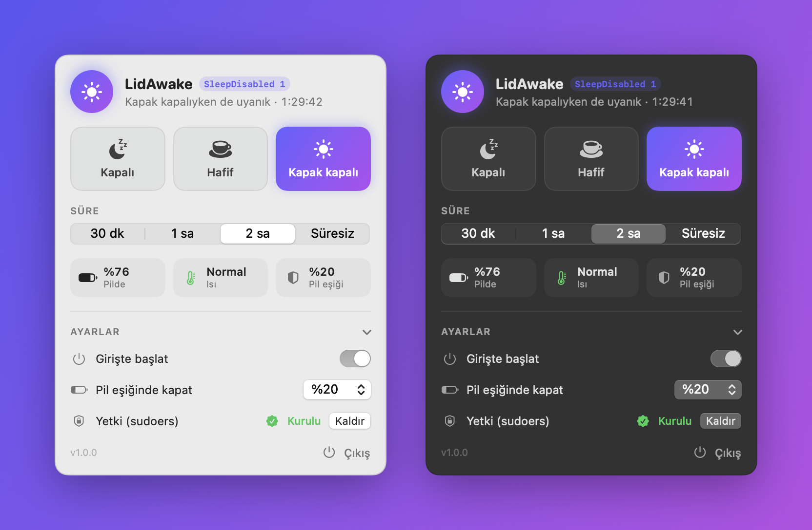

<p align="center">
  
</p>

<h1 align="center">LidAwake</h1>

<p align="center">
  MacBook'unu <b>kapak kapalıyken bile</b> uyanık tutan, menü çubuğundan tek tıkla kontrol edilen küçük, native bir macOS uygulaması.<br>
  <sub>A tiny native macOS menu bar app that keeps your MacBook awake — even with the lid closed.</sub>
</p>

<p align="center">
  
</p>

## Özellikler

| Mod | Ne yapar | Nasıl |
|---|---|---|
| **Kapalı** | Mac normal enerji ayarlarına göre uyur. | — |
| **Hafif** | Boşta uykuyu engeller, ekran kapanabilir. Kapak kapanırsa Mac **uyur**. | `IOPMAssertion` (`caffeinate -i` ile aynı) |
| **Kapak kapalı** | Kapak kapalıyken, harici monitör ya da şarj olmadan bile uyumaz. | `pmset -a disablesleep 1` |

- **Süre:** 30 dk · 1 sa · 2 sa · Süresiz — süre dolunca otomatik kapanır.
- **Pil eşiği:** Pilde çalışırken şarj seçilen eşiğin (varsayılan **%20**) altına inerse otomatik kapatır ve bildirim gönderir.
- **Isı koruması:** macOS termal durumu *Kritik* olursa kapak kapalı modu kapatılır.
- **Her zaman geri alır:** Çıkışta, `SIGTERM`/`SIGINT`/`SIGHUP`'ta ve kapatma/yeniden başlatmada `disablesleep 0` yapılır. Uygulama çökse veya zorla öldürülse bile bir sonraki açılışta ayar geri alınır.
- **Girişte başlat:** `SMAppService.mainApp` ile; ilk açılışta varsayılan olarak **açık**, ayarlardan kapatılabilir.
- Dock ikonu yok (`LSUIElement`), açık/koyu mod uyumlu, SF Symbols ile durum ikonu (🌙 kapalı · ☕ hafif · ☀️ kapak kapalı).
- Başlıktaki `SleepDisabled 1` rozeti doğrudan `pmset -g` çıktısını gösterir — gerçekte ne olduğunu her zaman görürsün.

## Kurulum

### Hazır sürüm
[Releases](../../releases) sayfasından `LidAwake-x.y.z.zip`'i indir, açıp `LidAwake.app`'i **Uygulamalar** klasörüne taşı.

Uygulama ad-hoc imzalı (Apple Developer ID ile noter onaylı değil). İlk açılışta macOS uyarı verirse:

```bash
xattr -dr com.apple.quarantine /Applications/LidAwake.app
```

ya da Finder'da sağ tık → **Aç**.

### Kaynaktan derleme
Sadece Xcode Command Line Tools yeterli (macOS 13+):

```bash
git clone https://github.com/dikeckaan/AwakeMAC.git
cd AwakeMAC
./scripts/build.sh --install   # build/LidAwake.app üretir, /Applications'a kopyalar ve açar
```

Diğer seçenekler: `./scripts/build.sh` (yalnızca derle), `./scripts/build.sh --zip` (`dist/` altına release zip'i).
Proje bir Swift Package olduğu için `Package.swift` doğrudan Xcode ile de açılabilir; `xcodebuild -scheme LidAwake` de çalışır (Xcode yüklüyse), ancak `.app` paketini `build.sh` oluşturur.

## Yetki nasıl alınıyor? (güvenlik)

`pmset -a disablesleep` root yetkisi ister. LidAwake bunun için **en dar** yolu kullanır:

1. Ayarlar'daki **Kur…** düğmesine bastığında macOS'in kendi yönetici penceresi açılır (AppleScript `do shell script … with administrator privileges`). Şifreni **macOS sorar**; LidAwake şifreyi görmez, saklamaz, Anahtar Zinciri'ne yazmaz.
2. Bu tek seferlik işlem `/etc/sudoers.d/lidawake` dosyasını oluşturur. İçinde yalnızca şu kural vardır:

   ```
   <kullanıcı-adın> ALL=(root) NOPASSWD: /usr/bin/pmset -a disablesleep 1, /usr/bin/pmset -a disablesleep 0
   ```

   Yani şifresiz çalıştırılabilen tek şey bu **iki tam komuttur** — başka argüman, başka komut yok.
3. Dosya `root:wheel 0440` izinleriyle yazılır ve yerine konmadan önce `visudo -cf` ile doğrulanır; geçersizse hiçbir şey değişmez.
4. Sonrasında uygulama `sudo -n /usr/bin/pmset -a disablesleep 1|0` çalıştırır (`-n`: asla şifre sormaz).

**Kaldırmak için:** Ayarlar → Yetki → **Kaldır** ya da:

```bash
sudo rm /etc/sudoers.d/lidawake
sudo pmset -a disablesleep 0
```

> Neden privileged helper (SMAppService daemon) değil? Bir launchd daemon'u kalıcı olarak root'ta çalışan bir süreç ve XPC arayüzü demek; ayrıca düzgün çalışması için Developer ID imzası gerekir. Tek bir sabit komut için sudoers kuralı hem daha küçük bir saldırı yüzeyi hem de denetlemesi (tek satır) daha kolay bir çözüm.

## ⚠️ Uyarılar

- Kapak kapalıyken Mac'in ısısını atması zorlaşır. **Çantada, kumaş üstünde veya kapalı bir alanda** kullanma.
- Pilde uzun süre kullanacaksan pil eşiğini açık tut.
- Elle kontrol: `pmset -g | grep SleepDisabled` (satır yoksa ya da `0` ise uyku normal).

## Nasıl çalışıyor?

```
Sources/LidAwake/
├── App.swift              MenuBarExtra + AppDelegate (çıkış/sinyal/kapatmada geri alma)
├── AwakeController.swift  Mod, süre, pil/ısı güvenliği, çökme sonrası kurtarma
├── SleepControl.swift     pmset + sudoers kurulumu
├── PowerInfo.swift        IOKit pil bilgisi, termal durum
├── LoginItem.swift        SMAppService.mainApp
├── MenuContentView.swift  Arayüz
└── Snapshot.swift         README görselleri (LidAwake --snapshot <klasör>)
```

---

## English

**LidAwake** is a native SwiftUI `MenuBarExtra` app (no Dock icon) that keeps your Mac awake:

- **Light** mode — prevents idle system sleep via an IOPM assertion (like `caffeinate -i`); the display may sleep.
- **Lid closed** mode — runs `pmset -a disablesleep 1`, so the Mac stays awake even with the lid closed, no external display or charger required.
- Timers (30 min / 1 h / 2 h / indefinite), auto-off below a battery threshold (default 20 %) and on critical thermal state, launch at login via `SMAppService` (on by default).
- The setting is **always reverted** (`disablesleep 0`) on quit, on SIGTERM/SIGINT/SIGHUP, on shutdown, and on next launch after a crash.
- **Privileges:** a one-time setup writes `/etc/sudoers.d/lidawake`, allowing *only* `/usr/bin/pmset -a disablesleep 1` and `… 0` without a password. Your password is entered in macOS' own admin prompt and is never seen or stored by the app. The file is validated with `visudo -cf` before being installed.
- Build: `./scripts/build.sh --install` (Command Line Tools are enough; macOS 13+).

## Lisans / License

[MIT](LICENSE)
