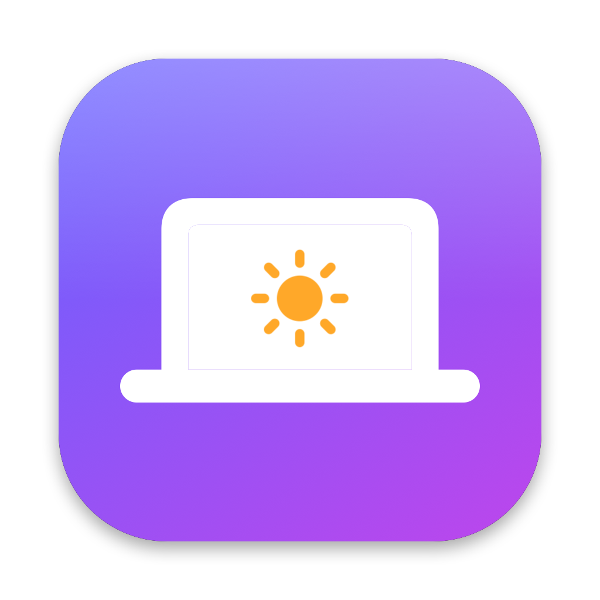

<p align="center">
  
</p>

<h1 align="center">Awake Mac</h1>

<p align="center">
  MacBook'unu <b>kapak kapalıyken bile</b> uyanık tutan, menü çubuğundan tek tıkla kontrol edilen küçük, native bir macOS uygulaması.<br>
  <sub>A tiny native macOS menu bar app that keeps your MacBook awake — even with the lid closed.</sub>
</p>

<p align="center">
  
</p>

## Özellikler

| Mod | Ne yapar | Nasıl |
|---|---|---|
| **Kapalı** | Mac normal enerji ayarlarına göre uyur. | — |
| **Hafif** | Boşta uykuyu engeller, ekran kapanabilir. Kapak kapanırsa Mac **uyur**. | `IOPMAssertion` (`caffeinate -i` ile aynı) |
| **Kapak kapalı** | Kapak kapalıyken, harici monitör ya da şarj olmadan bile uyumaz. | `pmset -a disablesleep 1` |

- **Süre:** 30 dk · 1 sa · 2 sa · Süresiz; `⋯` menüsünden 15 dk, 3/4/8 sa, **belirli saate kadar** ve **+30 dk uzat**. Süre dolunca otomatik kapanır.
- **Pil eşiği:** Pilde çalışırken şarj seçilen eşiğin (varsayılan **%20**) altına inerse otomatik kapatır ve bildirim gönderir.
- **Isı koruması:** *Sıcak* seviyesinde bildirim gelir; *Kritik* olursa kapak kapalı modu kapatılır.
- **Kapak kapanınca ekranı kilitle** (varsayılan açık): Mac uyumadığı için normalde kilitlenmezdi; kapağı açan biri doğrudan masaüstünü görmesin diye anında kilitlenir.
- **Yalnızca şarjdayken** seçeneği: kapak kapalı mod adaptör takılı değilse açılmaz, kablo çıkınca anında kapanır.
- **Bitmeden 5 dk önce** "+30 dk" düğmeli bildirim.
- **Her zaman geri alır:** Çıkışta, `SIGTERM`/`SIGINT`/`SIGHUP`'ta ve kapatma/yeniden başlatmada `disablesleep 0` yapılır. Uygulama çökse veya zorla öldürülse bile bir sonraki açılışta ayar geri alınır.
- **Seçimi hatırla:** Kapalıyken seçim tek seferliktir (yeniden başlatınca *Kapalı*). Açıkken seçtiğin mod yeniden başlatma/girişten sonra kalan süresiyle birlikte geri gelir; süresi dolmuşsa gelmez, pil/ısı korumaları yine geçerlidir.
- **Girişte başlat:** `SMAppService.mainApp` ile; ilk açılışta varsayılan olarak **açık**, ayarlardan kapatılabilir.
- **Akıllı tetikleyiciler:** seçilen uygulamalar açıkken, belirli komutlar (ffmpeg, rsync, xcodebuild…) çalışırken, indirme/yükleme sürerken, şarj adaptörü veya harici ekran bağlıyken ve her gün belirli saatlerde (ör. 01:00–07:00) otomatik uyanık kalır; koşul bitince kapanır. Elle seçim her zaman önceliklidir.
- **Hızlı kullanım:** global kısayol **⌥⌘A**, menü ikonuna **sağ tık** ile hızlı menü, menü çubuğunda **kalan süre**, isteğe bağlı **ekranı da açık tut**.
- **Otomasyon:** `awakemac://lid?minutes=60`, `awakemac://light`, `awakemac://toggle`, `awakemac://off` adresleri ve **Kısayollar (Shortcuts)** eylemleri.
- **Güncelleme denetimi:** GitHub Releases günde bir kez kontrol edilir (kapatılabilir).
- Dock ikonu yok (`LSUIElement`), açık/koyu mod uyumlu, SF Symbols ile durum ikonu (🌙 kapalı · ☕ hafif · ☀️ kapak kapalı).
- Başlıktaki `SleepDisabled 1` rozeti doğrudan `pmset -g` çıktısını gösterir — gerçekte ne olduğunu her zaman görürsün.
- **15 dil:** Türkçe, English, Deutsch, Français, Español, Italiano, Português (BR), Nederlands, Polski, Русский, Українська, 日本語, 한국어, 简体中文, العربية — sistem diline göre otomatik seçilir. Çeviriler tek dosyada: [`scripts/translations.py`](scripts/translations.py).
- **Hafif:** Tamamen olay güdümlü — pil, şarj, ısı, kapak ve uygulama değişiklikleri macOS bildirimleriyle gelir; boştayken zamanlayıcı ya da alt süreç yok (**%0 CPU**, ~80–95 MB bellek). Komut/ağ tetikleyicisi seçiliyse yalnızca 30 sn'de bir örnekleme yapılır.

### Test edildi
MacBook'ta (macOS 27.2, pilde, harici monitör yok) *Kapak kapalı* modu açıkken kapak 3 dk 13 sn kapalı tutuldu: 5 saniyelik kayıtlarda hiç boşluk olmadı, `pmset -g log`'da uyku kaydı oluşmadı. Uygulamadan çıkınca `SleepDisabled` tekrar `0` oldu.

## Kurulum

### Hazır sürüm
[Releases](../../releases) sayfasından `AwakeMac-x.y.z.zip`'i indir, açıp `Awake Mac.app`'i **Uygulamalar** klasörüne taşı.

1.2.0'dan itibaren sürümler **Developer ID ile imzalı ve Apple tarafından noter onaylıdır** — uyarısız açılır.

Homebrew ile:

```bash
brew install --cask dikeckaan/tap/awake-mac
```

### Kaynaktan derleme
Hızlı yerel derleme için Command Line Tools yeterli (macOS 13+):

```bash
git clone https://github.com/dikeckaan/AwakeMAC.git
cd AwakeMAC
./scripts/build.sh --install   # "build/Awake Mac.app" üretir, /Applications'a kopyalar ve açar
```

- `swift test` — birim testleri (zaman penceresi, sürüm karşılaştırma, URL komutları, 15 dilin eksiksiz ve biçim olarak güvenli olduğu).
- `AwakeMac.xcodeproj` — Xcode ile aç, çalıştır ya da arşivle.
- `TEAM_ID=XXXXXXXXXX ./scripts/release.sh --publish` — Xcode'da giriş yapılmış hesapla **Developer ID imzası + noter onayı + staple**, ardından GitHub release (şifre gerekmez).
- Çeviriler: [`scripts/translations.py`](scripts/translations.py) ve [`scripts/strings_more.py`](scripts/strings_more.py) → `python3 scripts/translations.py`.

## Yetki nasıl alınıyor? (güvenlik)

`pmset -a disablesleep` root yetkisi ister. Awake Mac bunun için **en dar** yolu kullanır:

1. Ayarlar'daki **Kur…** düğmesine bastığında macOS'in kendi yönetici penceresi açılır (AppleScript `do shell script … with administrator privileges`). Şifreni **macOS sorar**; Awake Mac şifreyi görmez, saklamaz, Anahtar Zinciri'ne yazmaz.
2. Bu tek seferlik işlem `/etc/sudoers.d/awakemac` dosyasını oluşturur. İçinde yalnızca şu kural vardır:

   ```
   <kullanıcı-adın> ALL=(root) NOPASSWD: /usr/bin/pmset -a disablesleep 1, /usr/bin/pmset -a disablesleep 0
   ```

   Yani şifresiz çalıştırılabilen tek şey bu **iki tam komuttur** — başka argüman, başka komut yok.
3. Dosya `root:wheel 0440` izinleriyle yazılır ve yerine konmadan önce `visudo -cf` ile doğrulanır; geçersizse hiçbir şey değişmez.
4. Sonrasında uygulama `sudo -n /usr/bin/pmset -a disablesleep 1|0` çalıştırır (`-n`: asla şifre sormaz).

**Kaldırmak için:** Ayarlar → Yetki → **Kaldır** ya da:

```bash
sudo rm /etc/sudoers.d/awakemac
sudo pmset -a disablesleep 0
```

> Neden privileged helper (SMAppService daemon) değil? Bir launchd daemon'u kalıcı olarak root'ta çalışan bir süreç ve XPC arayüzü demek; ayrıca düzgün çalışması için Developer ID imzası gerekir. Tek bir sabit komut için sudoers kuralı hem daha küçük bir saldırı yüzeyi hem de denetlemesi (tek satır) daha kolay bir çözüm.

## ⚠️ Uyarılar

- Kapak kapalıyken Mac'in ısısını atması zorlaşır. **Çantada, kumaş üstünde veya kapalı bir alanda** kullanma.
- Pilde uzun süre kullanacaksan pil eşiğini açık tut.
- Elle kontrol: `pmset -g | grep SleepDisabled` (satır yoksa ya da `0` ise uyku normal).

## App Store?

Bu sürüm App Store'a konamaz: App Store uygulamaları sandbox içinde çalışmak zorunda ve root yetkisi (`pmset`, sudoers) istemek yasak (App Review 2.4.5). Kapak kapalı mod, ekran kilitleme (özel API) ve uygulama içi güncelleme bu yüzden mağaza dışında kalır. Hafif mod, süreler, tetikleyiciler ve kısayollar ise sandbox içinde de çalışabilir — ileride ayrı bir "Lite" sürüm olarak düşünülebilir.

## Nasıl çalışıyor?

```
Sources/AwakeMac/
├── App.swift              NSStatusItem + NSPopover, sağ tık menüsü, ⌥⌘A, URL şeması, AppDelegate
├── AwakeController.swift  Modlar, süre, güvenlik, tetikleyici entegrasyonu, bildirimler, çökme kurtarma
├── Triggers.swift         Uygulama/komut/ağ/şarj/ekran/zamanlama tetikleyicileri, güncelleme denetimi
├── SystemMonitors.swift   IOKit güç/kapak olayları, ekran kilidi, Carbon kısayol, süreç ve ağ sayaçları
├── SleepControl.swift     pmset + sudoers kurulumu
├── Prefs.swift            Tüm ayarlar (UserDefaults)
├── Logic.swift            Saf mantık (zaman penceresi, sürüm, URL) — birim testli
├── PopoverView.swift      Menü çubuğu paneli
├── SettingsView.swift     Sekmeli Ayarlar penceresi ve ilk açılış ekranı
├── Intents.swift          Kısayollar (App Intents)
├── PowerInfo.swift · LoginItem.swift · Localization.swift · Snapshot.swift
```

---

## English

**Awake Mac** is a native SwiftUI menu bar app (no Dock icon) that keeps your Mac awake:

- **Light** mode — prevents idle system sleep via an IOPM assertion (like `caffeinate -i`); the display may sleep.
- **Lid closed** mode — runs `pmset -a disablesleep 1`, so the Mac stays awake even with the lid closed, no external display or charger required.
- Timers (30 min / 1 h / 2 h / indefinite, custom, until a time, +30 min), auto-off below a battery threshold (default 20 %) and on critical thermal state, heat warnings, optional "lid mode only on power adapter", **screen lock when the lid closes**, a 5-minute warning with a "+30 min" action, launch at login via `SMAppService`.
- **Triggers:** stay awake automatically while chosen apps or commands run, during network transfers, on power adapter, with an external display, or on a daily schedule.
- Global shortcut ⌥⌘A, right-click quick menu, remaining time in the menu bar, `awakemac://` URLs and Shortcuts actions, update check via GitHub Releases.
- The setting is **always reverted** (`disablesleep 0`) on quit, on SIGTERM/SIGINT/SIGHUP, on shutdown, and on next launch after a crash.
- **Privileges:** a one-time setup writes `/etc/sudoers.d/awakemac`, allowing *only* `/usr/bin/pmset -a disablesleep 1` and `… 0` without a password. Your password is entered in macOS' own admin prompt and is never seen or stored by the app. The file is validated with `visudo -cf` before being installed.
- "Remember selection" (off by default) restores the chosen mode, including the remaining time, after restart/login.
- Localized into 15 languages; idle CPU usage is 0% (no timers or child processes while off).
- Releases are Developer ID signed and notarized. Build: `./scripts/build.sh --install`; signed release: `TEAM_ID=… ./scripts/release.sh`; tests: `swift test`.

## Lisans / License

[MIT](LICENSE)
